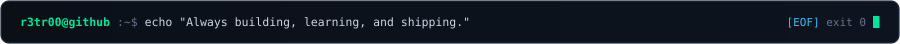

<p align="center">
  
</p>

## `$ cat about.yml`

Software engineer focused on **AI / Machine Learning** and **Python**, paired with a strong foundation in **backend engineering (.NET / C# & SQL)**. I enjoy turning data and deep learning models into practical, production-ready systems.

```yaml
handle:    R3TR00
name:      Huzayfah Nasef
role:      AI / Machine Learning & Backend Engineer
focus:
  - Applied Machine Learning & Deep Learning (Python, TensorFlow, Pandas)
  - Backend Systems & APIs (ASP.NET / .NET, C#, SQL)
  - Full-Stack Web Integrations (Angular, TypeScript)
education:
  - Computer Science — Benha Faculty of Computers & Artificial Intelligence (BFCAI)
  - Machine Learning & Deep Learning — Samsung Innovation Campus
contact:   hozifa512@gmail.com
```

---

## `$ ls -la ./stack/`

| Directory | Stack |
| :--- | :--- |
| **`ai-ml/`** |     |
| **`backend/`** |     |
| **`frontend/`** |     |
| **`databases/`** |   |
| **`tools/`** |     |

---

## `$ ./connect.sh`

<p align="left">
  <a href="mailto:hozifa512@gmail.com">
    
  </a>
  <a href="https://linkedin.com/in/hozifa-nasef" target="_blank" rel="noreferrer">
    
  </a>
  <a href="https://x.com/hozifanasef" target="_blank" rel="noreferrer">
    
  </a>
  <a href="https://kaggle.com/hozifanasef" target="_blank" rel="noreferrer">
    
  </a>
  <a href="https://stackoverflow.com/users/16672185" target="_blank" rel="noreferrer">
    
  </a>
</p>

<br />

<p align="center">
  
</p>
